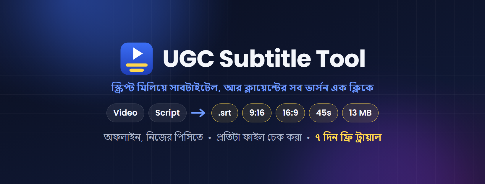

# UGC Subtitle Tool

**ভিডিওর কথা থেকে সাবটাইটেল (.srt), স্ক্রিপ্টের সাথে মিলিয়ে দেখা, আর ক্লায়েন্টের সব ভার্সন — 9:16, 16:9, 45 সেকেন্ডের কাট, 13 MB-র ফাইল — সাবটাইটেলসহ এক ক্লিকে।**

## ⬇️ ডাউনলোড / Download

### [Releases — সর্বশেষ ভার্সন (latest version)](https://github.com/ocpabdurrahim/ugc-subtitle-tool/releases/latest)

Releases পেজে **Assets**-এর নিচ থেকে ইনস্টলার (UGC-Subtitle-Tool-Setup) ডাউনলোড করুন।
On the Releases page, download the installer (UGC-Subtitle-Tool-Setup) under **Assets**.

৭ দিন ফ্রি ট্রায়াল • 7-day free trial
লাইসেন্স কিনতে / To buy a license: **WhatsApp 01912-007750 (+880 1912-007750)** ([chat](https://wa.me/8801912007750))

> "Source code" ফাইলগুলো প্রোগ্রাম নয়। / The "Source code" files on the Releases page are not the program.

---

## বাংলা

UGC অ্যাড, প্রোডাক্ট ভিডিও বা রিলে সাবটাইটেল দেন? ক্লায়েন্ট স্ক্রিপ্ট পাঠায়, আপনি সাবটাইটেল বানান, তারপর একই ভিডিওর ৫টা ভার্সন এক্সপোর্ট করেন — প্রতিটার আলাদা সাইজ, দৈর্ঘ্য আর লিমিট। UGC Subtitle Tool এই পুরো কাজটা করে দেয়।

**যা করে**
- ভিডিওর কথা শুনে সাবটাইটেল (.srt) বানায়, প্রতিটা শব্দের সময়ের সাথে মিলিয়ে — ২ লাইন × ২৮ অক্ষর (9:16), ২ × ৪৩ (16:9) বা নিজের মাপে
- স্ক্রিপ্টের (.docx / .txt) সাথে মিলিয়ে দেখে: কোথায় বক্তা অন্য শব্দ বলেছেন, কী বাদ দিয়েছেন, কী যোগ করেছেন — রিপোর্ট (.txt + .docx) ক্লায়েন্টকে পাঠানো যায়
- স্ক্রিপ্টের বানান আর যতিচিহ্ন রাখে, যেখানে বক্তা স্ক্রিপ্ট মেনেছেন
- এক ক্লিকে সব ভার্সন এক্সপোর্ট, সাবটাইটেল বসানো: 9:16, 16:9 (ঝাপসা ব্যাকগ্রাউন্ডে), 1:1, 4:5, ছোট কাট (যেমন ৪৩ সেকেন্ডের মধ্যে, পুরো বাক্যে শেষ), সাইজ লিমিট (যেমন ১৩ MB-র নিচে)
- ছোট কাট কাটে বাক্যের শেষে, কথার বিরতিতে — কোনো শব্দ কাটা পড়ে না
- প্রতিটা ফাইল মেপে দেখে: সাইজ, দৈর্ঘ্য, রেজোলিউশন, বিটরেট — চেক রিপোর্ট সেভ করে
- প্রিসেট: ভার্সন, ফন্ট (পিসির যেকোনো ফন্ট), সাইজ, রং, আউটলাইন, শ্যাডো, পজিশন — লাইভ প্রিভিউসহ
- বাংলা, হিন্দি, আরবি, ইংরেজিসহ অনেক ভাষা
- সব কাজ নিজের পিসিতে, অফলাইন: কোনো আপলোড বা মাসিক ফি নেই

**যা লাগবে:** Windows 10/11 (64-bit) • প্রথমবার ইন্টারনেট (স্পিচ মডেল ~১.৬ GB, একবারই) • ~৩ GB ফাঁকা জায়গা। গ্রাফিক্স কার্ড থাকলে এক্সপোর্ট আরও দ্রুত (Intel, NVIDIA, AMD)।

**ইনস্টল**
1. উপরের Releases লিংক থেকে ইনস্টলার ডাউনলোড করুন।
2. ডাবল ক্লিক করুন। "Windows protected your PC" দেখালে: **More info > Run anyway**।
3. Next চাপুন (অ্যাডমিন পাসওয়ার্ড লাগে না)। শেষে UGC Subtitle Tool খুলবে।

**ব্যবহার**
1. **Browse...** দিয়ে প্রজেক্ট ফোল্ডার বেছে নিন (ভিডিও আর স্ক্রিপ্ট এক ফোল্ডারে)।
2. **Create subtitles** — সাবটাইটেল আর রিপোর্ট ভিডিওর পাশে সেভ হয়।
3. সাবটাইটেল দেখে নিন, দরকার হলে ঠিক করুন।
4. প্রিসেট বেছে **Export videos** — সব ভার্সন Export ফোল্ডারে।

**ট্রায়াল ও লাইসেন্স:** প্রথম দিন থেকে ৭ দিন সব ফ্রি। তারপর নিচে ডানদিকে **License...** চাপুন, নাম লিখে **Buy on WhatsApp** (অথবা "Copy request" চেপে পাঠান): **01912-007750 (+880 1912-007750)**। আপনার পিসির জন্য লাইসেন্স কী পাবেন (লাইফটাইম, এক পিসি)। Windows বা টুল আবার ইনস্টল করলেও লাইসেন্স থাকে।

---

## English

You subtitle UGC ads, product videos or reels. The client sends a script, you make the subtitles, then export the same video five ways — each with its own size, length and limits. UGC Subtitle Tool does all of it.

**What it does**
- Makes subtitles (.srt) from the speech, timed to every word — 2 lines × 28 characters (9:16), 2 × 43 (16:9) or your own size
- Checks the video against the script (.docx / .txt): words the speaker changed, skipped or added — a report (.txt + .docx) you can send to the client
- Keeps the script's spelling and punctuation wherever the speaker followed it
- Exports every version in one click, subtitles burned in: 9:16, 16:9 (over a blurred background), 1:1, 4:5, short cuts (e.g. under 43 seconds, ending on a full sentence), size limits (e.g. under 13 MB)
- Cuts short versions at the end of a sentence, in the pause after the last word — no clipped words
- Measures every file it makes: size, length, resolution, bitrates — and saves a check report
- Presets: versions, font (any font on your PC), size, colour, outline, shadow, position — with a live preview
- Many languages, including Bangla, Hindi, Arabic and English
- Everything runs on your PC, offline: no upload, no subscription

**Needs:** Windows 10/11 (64-bit) • internet once (speech model ~1.6 GB, first run only) • ~3 GB free space. A graphics card makes exports faster (Intel, NVIDIA, AMD).

**Install**
1. Download the installer from the Releases link above.
2. Double-click it. If Windows says "Windows protected your PC": **More info > Run anyway**.
3. Click Next (no admin password needed). UGC Subtitle Tool opens at the end.

**Use**
1. **Browse...** to the project folder (video and script in one folder).
2. **Create subtitles** — the subtitles and the report are saved next to the video.
3. Check the subtitles and correct them if needed.
4. Choose a preset and click **Export videos** — every version lands in the Export folder.

**Trial and license:** everything works for 7 days. Then click **License...** (bottom right), type your name and click **Buy on WhatsApp** (or "Copy request" and send it) to **01912-007750 (+880 1912-007750)** to buy a lifetime license for that PC. The license survives reinstalling Windows or the tool.

---

**More tools:** [Graphics Translator](https://github.com/ocpabdurrahim/graphics-translator) (translates Premiere text graphics) • [Graphics Voice-over](https://github.com/ocpabdurrahim/graphics-voice-over) (AI voice-over from the captions) • [Project Sync](https://github.com/ocpabdurrahim/project-sync) (folders ↔ Premiere bins)

Uses FFmpeg (GPL, a separate program) and Whisper (MIT). See THIRD-PARTY-NOTICES.txt in the program folder.
